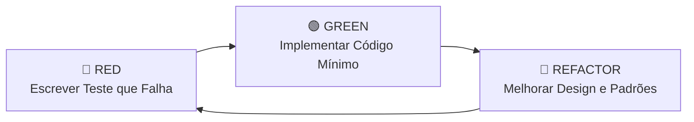

# Fluxo de Trabalho TDD (Red - Green - Refactor)

Este guia serve como diretriz obrigatória de execução para o **`dev-agent`** durante a implementação de qualquer tarefa marcada com `[TDD]`.

---

## O Ciclo Sagrado do TDD

### 1. Fase RED (Vermelho)
1. Escreva o teste automatizado unitário ou de integração para a funcionalidade descrita na tarefa.
2. O teste deve expressar o comportamento esperado a partir dos Critérios de Aceite da `spec.md`.
3. **Execute o teste e certifique-se de que ele FALHA.** A falha deve ocorrer pelo motivo esperado (ex.: classe ou método ainda não implementado, asserção não atendida), e não por erro de sintaxe do próprio teste.

### 2. Fase GREEN (Verde)
1. Escreva a quantidade **mínima e suficiente** de código de produção para fazer o teste passar.
2. Evite abstrações precoces nesta fase. O foco é obter a luz verde na suite de testes o mais rápido possível.
3. **Execute o teste novamente e comprove o status de sucesso (PASS).**

### 3. Fase REFACTOR (Refatoração)
1. Agora que o teste garante que o comportamento está protegido, melhore a qualidade do código:
   - Aplique os princípios SOLID (SRP, OCP, LSP, ISP, DIP).
   - Aplique DDD (elimine Primitive Obsession, crie Value Objects, proteja invariantes de Entidades).
   - Remova duplicações e respeite o princípio KISS (código simples, legível e direto).
2. **Execute os testes novamente após a refatoração.** Todos os testes devem continuar verdes.

---

## Boas Práticas de Testes

- **Testes de Unidade (Domínio):** Não use bancos de dados ou frameworks. Use objetos em memória.
- **Testes de Aplicação (Use Cases):** Use repositórios fake em memória (In-Memory Repository) ou mocks para isolar de I/O externo.
- **Nomenclatura Clara:** O nome do teste deve descrever o cenário e o resultado esperado:
  `deve_lancar_erro_quando_o_documento_for_invalido()` ou
  `should_create_order_when_stock_is_available()`.
