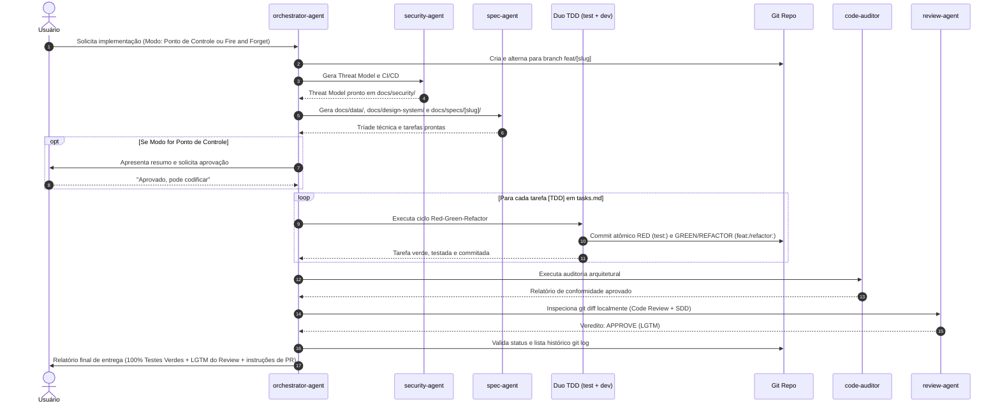

# Skill: Orchestrator (Multi-Agent Engineering Pipeline Manager)

Esta skill é responsável por **orquestrar o ciclo completo de engenharia de software**, despachando os subagentes especializados na ordem correta, gerenciando o ciclo TDD e oferecendo ao usuário a escolha entre **Modo Ponto de Controle** e **Modo Fire and Forget**.

Ela atua através do subagente dedicado **`orchestrator-agent`** (Engineering Manager & Multi-Agent Orchestrator).

---

## Arquivos desta Skill

| Arquivo                         | Finalidade                                                                                               |
| :------------------------------ | :------------------------------------------------------------------------------------------------------- |
| `agent-prompt.md`               | Definição de role (Engineering Manager / Multi-Agent Orchestrator), modelo e system prompt do subagente. |
| `references/pipeline-states.md` | Máquina de estados da esteira e detalhamento dos dois modos de execução.                                 |

---

## Os 2 Modos de Execução da Esteira

### 1. Modo Ponto de Controle (Checkpoint / Human-in-the-Loop — Padrão)

- O orquestrador aciona `security-agent` e `spec-agent`.
- **⏸️ Checkpoint:** Pausa antes de escrever qualquer código em `src/`, apresentando ao usuário o resumo da modelagem de dados, Design System e tarefas em `tasks.md`.
- O usuário valida e dá o comando de prosseguir (`"Aprovado"`).
- O orquestrador aciona o ciclo TDD (`test-agent` + `dev-agent`) até todos os testes ficarem verdes, seguido de `code-auditor` e do portão final local `review-agent`.

### 2. Modo Fire and Forget (Autônomo / Unattended / `/goal`)

- O orquestrador aciona toda a esteira de forma contínua sem pausas intermediárias:
  `security-agent` $\rightarrow$ `spec-agent` $\rightarrow$ `test-agent` + `dev-agent` (loop TDD) $\rightarrow$ `code-auditor` $\rightarrow$ `review-agent`.
- Paradas acontecem apenas se houver impedimento crítico insuperável.
- Entrega final apresentada diretamente com 100% dos testes verdes e parecer LGTM do Code Review.

---

## Fluxo Operacional da Esteira

