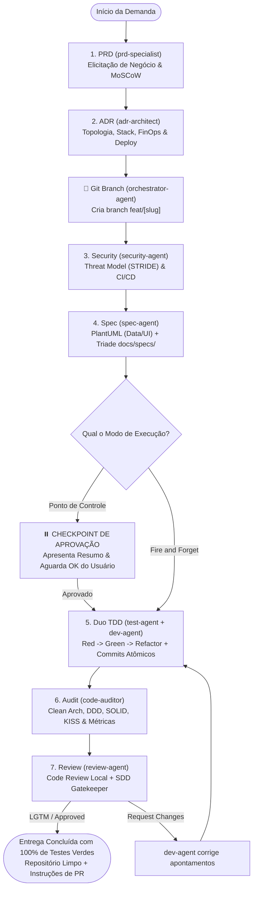

# Máquina de Estados da Esteira de Desenvolvimento (Pipeline States)

Este documento define os estados, transições e regras de negócio para a orquestração multiagente do projeto.

---

## 1. Diagrama Geral da Esteira

---

## 2. Detalhamento dos Dois Modos de Execução

### Modo A: Ponto de Controle (Human-in-the-Loop — Padrão)
* **Objetivo:** Dar ao usuário o controle visual e estratégico antes do início da codificação.
* **Comportamento:**
  1. Executa `prd` e `adr` (interativos com o usuário).
  2. Executa `security` e `spec` autonomamente.
  3. **PAUSA OBRIGATÓRIA:** Apresenta ao usuário:
     - Resumo da modelagem de dados e domínio (`docs/data/[slug].md`).
     - Resumo dos componentes visuais (`docs/design-system/[slug].md`).
     - Lista das tarefas que serão implementadas (`docs/specs/[slug]/tasks.md`).
     - Pergunta: *"O plano técnico está aprovado para iniciarmos a implementação TDD automática?"*
  4. Ao receber o *"Sim / Aprovado"*, dispara o ciclo TDD contínuo, seguido de auditoria arquitetural e inspeção local pelo `review-agent` até o veredito LGTM.

### Modo B: Fire and Forget (Autônomo / Unattended)
* **Objetivo:** Velocidade máxima sem interrupções humanas.
* **Comportamento:**
  1. Assume os requisitos do PRD e as diretrizes do ADR vigentes.
  2. Executa `security` e `spec` em sequência direta.
  3. **SEM PAUSA:** Transiciona imediatamente para o ciclo TDD (`test-agent` + `dev-agent`).
  4. Itera por todas as tarefas do checklist `tasks.md`, resolvendo cada teste vermelho até 100% verde.
  5. Aciona o `code-auditor` para validação de qualidade estática.
  6. Aciona o `review-agent` para inspeção minuciosa do git diff local (higiene, Clean Arch e SDD).
  7. Entrega ao usuário o relatório consolidado final com 100% dos testes verdes e parecer LGTM.

---

## 3. Higiene de Contexto & Comandos Operacionais

Como toda a inteligência e estado do projeto estão persistidos nos arquivos do disco (`docs/`, `AGENTS.md`, `test/`, `src/`), a memória do chat pode e deve ser compactada ou limpa sem risco de perda de informação:

| Momento na Esteira | Comando Recomendado | Objetivo / Benefício |
| :-- | :--: | :-- |
| **Após aprovar PRD e ADR** | `/compact` | Resume o longo diálogo de elicitação de negócio e FinOps antes de iniciar o design técnico. |
| **No Checkpoint (antes do TDD)** | `/compact` | Limpa a memória de trabalho antes do ciclo de testes e implementação, evitando degradação de atenção. |
| **Ao disparar Fire and Forget** | `/goal` | Informa que a tarefa é longa e autônoma, permitindo execução ininterrupta até a meta ser atingida. |
| **Ao concluir a feature inteira** | `/clear` | Zera a conversa para iniciar a próxima feature com contexto limpo e sem resíduos anteriores. |

### Regra Anti-Bloat de Logs de Terminal:
Os subagentes nunca devem despejar saídas brutas de 50+ linhas de terminal para o orquestrador ou usuário. Devem sintetizar exclusivamente o diagnóstico acionável (arquivo que falhou, asserção esperada vs recebida).
