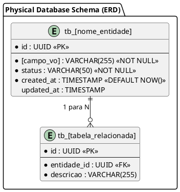

# Modelagem de Dados & Domínio: [Nome do Módulo / Sistema]

> **Status:** [Draft | Aprovado] | **Caminho:** `docs/data/[slug].md`  
> **ADR de Referência:** `docs/adr/ADR-[numero-slug].md` | **Versão:** 1.0.0 | **Autor:** `spec-agent`

---

## 1. Visão Geral da Modelagem

- **Finalidade:** Definir a estrutura conceitual de domínio (DDD) e a arquitetura de persistência física (ERD).
- **Diretrizes:** Domínio puro com invariantes protegidas, combate a modelos anêmicos e persistência otimizada com integridade referencial.

---

## 2. Diagrama de Classes de Domínio (DDD em PlantUML)

```plantuml
@startuml
skinparam linetype ortho
skinparam roundcorner 8
skinparam classAttributeIconSize 0

package "Domain Layer (DDD Model)" {
  class "[NomeEntidade]" << (E,#5DADE2) Entity / AggregateRoot >> {
    - id: UUID
    - status: [StatusEnum]
    - createdAt: DateTime
    + criar(params): [NomeEntidade]
    + [metodoNegocio](args): void
    + getInvariantes(): boolean
  }

  class "[NomeVO]" << (V,#F4D03F) ValueObject >> {
    - valor: String
    + getValor(): String
    - validar(valor): void
  }

  enum "[StatusEnum]" << (X,#BB8FCE) Enum >> {
    PENDENTE
    ATIVO
    CONCLUIDO
    CANCELADO
  }

  [NomeEntidade] *-- "1" [NomeVO] : compõe
  [NomeEntidade] --> "1" [StatusEnum] : estado
}
@enduml
```

---

## 3. Diagrama Entidade-Relacionamento Físico (ERD em PlantUML)



---

## 4. Dicionário de Dados e Estrutura Física

### Tabela: `tb_[nome_entidade]`
| Coluna | Tipo Físico | Nulo? | Padrão | Regras / Constraints |
| :-- | :-- | :--: | :-- | :-- |
| `id` | `UUID` | Não | `gen_random_uuid()` | Chave Primária (`PK`) |
| `[campo_vo]` | `VARCHAR(255)` | Não | - | Mapeia o Value Object `[NomeVO]` |
| `status` | `VARCHAR(50)` | Não | `'PENDENTE'` | `CHECK (status IN ('PENDENTE', 'ATIVO', ...))` |
| `created_at` | `TIMESTAMP` | Não | `NOW()` | Timestamp de criação |
| `updated_at` | `TIMESTAMP` | Sim | `NULL` | Atualizado via trigger/ORM |

---

## 5. Estratégia de Índices & Otimização de I/O

- **`idx_[tabela]_[campo]`**: Índice em `[campo]` para acelerar consultas de busca frequente.
- **`fk_[tabela]_[origem]`**: Foreign key com integridade referencial (`ON DELETE RESTRICT`).
