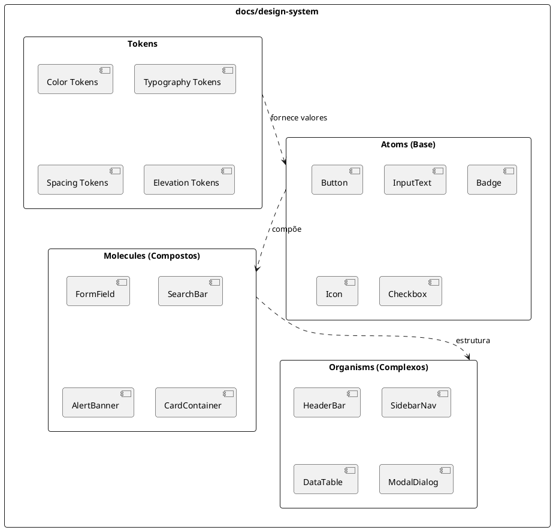

# Design System: [Nome da Aplicação / Módulo]

> **Status:** [Draft | Aprovado] | **Caminho:** `docs/design-system/[slug].md`  
> **ADR de Referência:** `docs/adr/ADR-[numero-slug].md` | **Versão:** 1.0.0 | **Autor:** `spec-agent`

---

## 1. Visão Geral e Princípios Visuais

- **Objetivo:** Estabelecer a linguagem visual unificada, tokens e componentes reutilizáveis.
- **Diretriz de Acessibilidade:** Conformidade estrita com WCAG 2.1 AA (contraste mínimo de 4.5:1 para texto normal e 3:1 para elementos de interface).

---

## 2. Design Tokens Fundamentais

| Categoria | Token | Valor / Escala | Uso Recomendado |
| :-- | :-- | :-- | :-- |
| **Cores** | `color-primary` | `[ex.: #2563EB]` | Ações principais, CTAs |
| | `color-background` | `[ex.: #F8FAFC]` | Fundo principal da página |
| | `color-surface` | `[ex.: #FFFFFF]` | Fundo de cards, modais e containers |
| | `color-text-main` | `[ex.: #0F172A]` | Textos com alto contraste |
| | `color-error` | `[ex.: #EF4444]` | Mensagens e bordas de erro |
| | `color-success` | `[ex.: #10B981]` | Confirmações e badges de sucesso |
| **Tipografia** | `font-family` | `[ex.: Inter, system-ui]` | Família tipográfica global |
| | `font-size-scale` | `[ex.: 12px(xs), 14px(sm), 16px(base), 20px(lg), 24px(xl)]` | Hierarquia de títulos e corpo |
| **Espaçamento** | `spacing-scale` | `[ex.: 4px(xs), 8px(sm), 16px(md), 24px(lg), 32px(xl)]` | Gaps, paddings e margens |
| **Bordas** | `radius-scale` | `[ex.: 4px(sm), 8px(md), 12px(lg), 9999px(full)]` | Inputs, botões, tags |
| **Elevação** | `shadow-scale` | `[ex.: shadow-sm, shadow-md, shadow-lg]` | Profundidade de modais e menus |

---

## 3. Diagrama de Componentes do Design System (PlantUML)

---

## 4. Matriz de Estados de Interação

Todo componente interativo deve implementar os seguintes 7 estados:

| Estado | Comportamento Visual Obrigatório |
| :-- | :-- |
| **Default** | Aparência base de repouso. |
| **Hover** | Variação sutil de brilho/cor de fundo indicando interatividade. |
| **Focus-Visible** | Anel de foco com contraste visível (`outline: 2px solid [color-primary]`). |
| **Active** | Feedback visual de clique/pressionamento. |
| **Disabled** | Opacidade reduzida (ex.: 50%), cursor `not-allowed`, sem eventos de ponteiro. |
| **Loading** | Spinner visível ou skeleton placeholder, desabilitando novas ações. |
| **Error** | Borda destacada em `color-error` acompanhada de mensagem textual com `aria-live`. |
