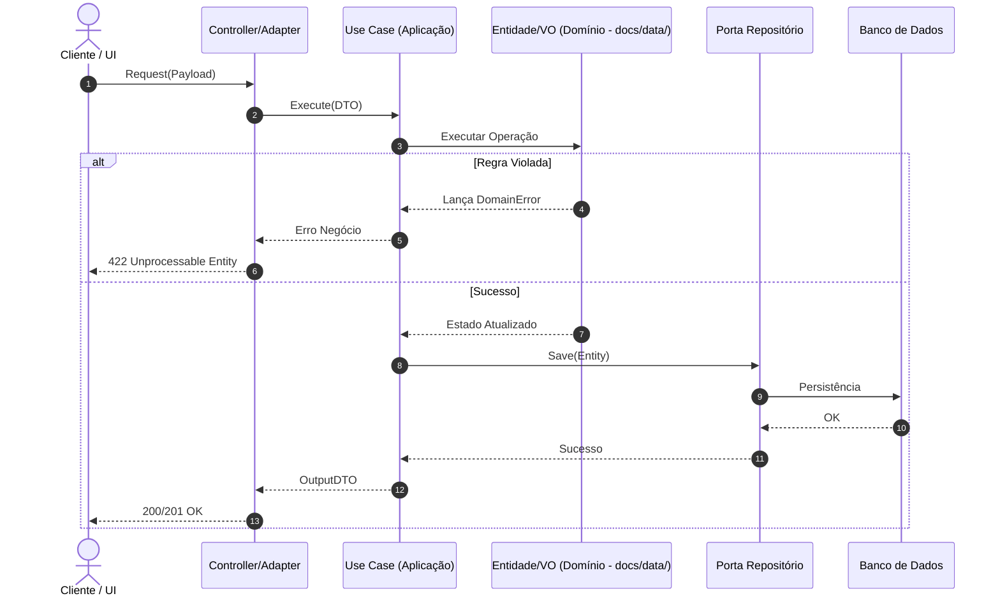

# Especificação Técnica: [Nome da Feature / Módulo]

> **Status:** [Draft | Aprovado] | **PRD:** `docs/prd/[AAAA-MM-DD-slug].md` | **ADR:** `docs/adr/ADR-[numero-slug].md`  
> **Modelagem de Dados:** `docs/data/[slug].md` | **Threat Model:** `docs/security/[slug]-threat-model.md`  
> **Versão:** 1.0.0 | **Autor:** `spec-agent`

---

## 1. Visão Geral e Fronteiras Técnicas

- **Objetivo:** [O que o sistema executa tecnicamente para atender o PRD]
- **Escopo Incluído:** [Fronteiras explícitas do módulo]
- **Escopo Excluído:** [O que não será contemplado nesta entrega]
- **Modelo de Dados de Referência:** Consultar diagramas e esquema em `docs/data/[slug].md`.

---

## 2. Requisitos Técnicos & Regras de Negócio

| ID | Requisito Técnico / Regra | Invariantes Mandatórias |
| :--: | :-- | :-- |
| **RT-01** | [Nome da Regra/Fluxo] | [Invariante estrita que nunca pode ser violada] |
| **RT-02** | [Nome da Regra/Fluxo] | [Invariante estrita que nunca pode ser violada] |

---

## 3. Critérios de Aceite BDD (Given-When-Then)

> *Estes critérios mapeiam 1:1 com os testes do `dev-agent` via `tasks.md`.*

### `[CA-01]` [Cenário Principal - Caminho Feliz]
- **Dado que** [estado inicial válido]
- **Quando** [ação disparada com payload válido]
- **Então** [estado resultante alterado com sucesso]
- **E** [efeito colateral ou evento emitido]

### `[CA-02]` [Cenário de Falha / Violação de Regra]
- **Dado que** [estado inicial ou entrada inválida]
- **Quando** [ação disparada]
- **Então** [erro de domínio específico lançado sem alterar estado]

---

## 4. Diagrama de Sequência de Execução

---

## 5. Threat Modeling & Segurança

> *Consulte a análise completa STRIDE + DREAD em `docs/security/[slug]-threat-model.md` elaborada pelo `security-agent`.*

| Vetor (STRIDE) | Risco Específico no Fluxo | Mitigação Técnica Obrigatória |
| :--: | :-- | :-- |
| **Spoofing** | Requisição de ator não autenticado | JWT válido validado em middleware |
| **Tampering** | Alteração indevida de dados | DTOs estritos com validação de esquema |
| **Repudiation** | Negação de operação crítica | Log estruturado (correlation-id + user-id) |
| **Info Disclosure** | Vazamento de dados sigilosos/PII | DTOs de saída limpos e mascaramento em logs |
| **Denial of Service** | Sobrecarga de CPU/Memória/DB | Rate limit e paginação obrigatória |
| **Elevation of Priv.** | Acesso a recursos de outro usuário (IDOR) | Verificação de posse do recurso no Use Case |

---

## 6. Questões em Aberto e Premissas

- [Premissa ou dependência de terceiros]
