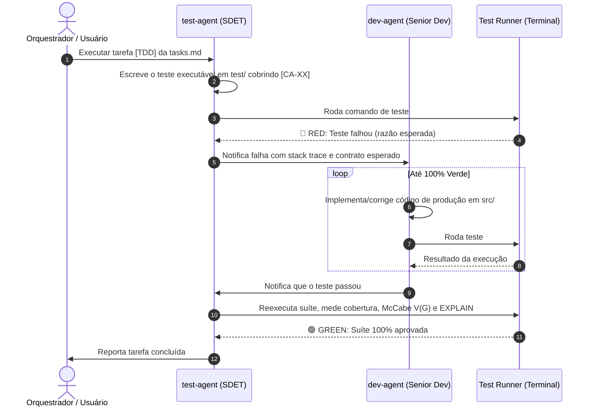

# Skill: Test (Test Automation & TDD Pairing)

Esta skill é responsável pela **automação executável de testes, cobertura de cenários críticos e de borda, auditoria de queries relacionais (EXPLAIN) e condução do ciclo TDD**.

Ela atua através do subagente dedicado **`test-agent`** (QA Lead & SDET) em colaboração direta com o **`dev-agent`**.

> 💡 **Princípio KISS:** Esta skill **NÃO gera documentos Markdown burocráticos** (sem `docs/test/`). A especificação viva e executável são os **arquivos de teste reais dentro da pasta `test/`**, que rodam via terminal e validam o comportamento do software na prática.

---

## Arquivos desta Skill

| Arquivo                         | Finalidade                                                                                        |
| :------------------------------ | :------------------------------------------------------------------------------------------------ |
| `agent-prompt.md`               | Definição de role (QA Lead & SDET), modelo e system prompt do subagente.                          |
| `references/test-heuristics.md` | Heurísticas avançadas (Boundary values, concorrência, idempotência, segurança, McCabe e EXPLAIN). |

---

## Saída Canônica da Skill

- **Suíte de Testes Automatizados Executáveis:** Pasta **`test/`** (ou `tests/`).
  - `test/domain/`: Testes unitários puros de Entidades e Value Objects.
  - `test/application/`: Testes de Casos de Uso com repositórios fake em memória.
  - `test/infrastructure/`: Testes de integração em banco real, validação de integridade de FKs e `EXPLAIN` de queries.
  - `test/adapters/`: Testes de API/HTTP (Controllers, rotas, códigos 200/400/422).
- **Diagnósticos de Terminal (`run_command`):** Relatórios imediatos de falha, cobertura de branches e análise de queries entregues ao `dev-agent`.

---

## O Ciclo TDD Ping-Pong (Colaboração `test-agent` + `dev-agent`)

---

## Fluxo de Execução Passo a Passo

### Passo 1 — Leitura dos Critérios BDD

1. Leia `docs/specs/[slug]/spec.md` para extrair os critérios de aceite BDD (`[CA-XX]`).
2. Leia `docs/data/[slug].md` para entender as entidades, VOs e relacionamentos físicos de banco.
3. Identifique a tarefa em andamento em `docs/specs/[slug]/tasks.md`.

### Passo 2 — Automação da Suíte & Commit RED

1. Crie o arquivo de teste correspondente na pasta `test/` (ex.: `test/domain/value-objects/[nome-vo].test.ts`).
2. Adicione cenários felizes e casos de borda usando `references/test-heuristics.md` (nulos, limites, injeções, concorrência).
3. Execute o teste via terminal (`run_command`) e comprove que ele falha pela razão correta (não por erro de sintaxe do teste).
4. Faça o commit atômico do teste: `git add test/` && `git commit -m "test(<escopo>): add failing tests for [CA-XX] <descrição>"`.
5. Transmita o diagnóstico sintético (Anti-Bloat: apenas arquivo, linha e asserção esperada vs obtida) ao **`dev-agent`**.

### Passo 3 — Acompanhamento e Validação (Fase GREEN)

1. Aguarde a implementação da solução em `src/` pelo **`dev-agent`**.
2. Execute a suíte de testes no terminal.
3. Se houver falha, forneça o diagnóstico exato ao **`dev-agent`** para correção iterativa.
4. Quando tudo estiver verde:
   - Valide a cobertura de linhas e branches.
   - Audite a Complexidade Ciclomática (bloquear métodos com $V(G) > 15$).
   - Em bancos relacionais: valide integridade de FKs (bloquear órfãos) e execute `EXPLAIN` nas queries críticas (bloquear N+1 e `Seq Scan`).
