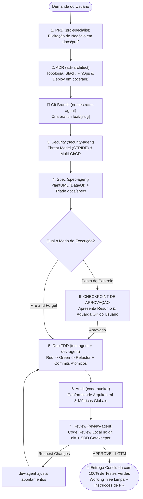

# 🚀 Agentic World — Esteira de Engenharia de Software Autônoma (Secure by Design)

> **Pacote universal de Agent Skills portáteis que implementa uma esteira completa de engenharia de software orientada a Secure by Design (SbD), transformando qualquer Agente de IA (Gemini, Claude, Antigravity, Cursor, etc.) em uma equipe autônoma de alta performance.**

---

## 📖 Visão Geral

O **Agentic World** é um ecossistema modular e padronizado no formato aberto **Agent Skills** (`.agents/skills/`). Ele estrutura uma esteira industrial de software que cobre desde a concepção da ideia até o código testado, auditado e revisado localmente, sem atrito e com conformidade arquitetural inegociável:

- **Secure by Design (SbD) & DevSecOps:** A segurança não é uma reflexão tardia, mas o princípio norteador desde a concepção (*Shift-Left Security*). Modelagem formal de ameaças (STRIDE + DREAD) antes do código, prevenção ativa contra o OWASP Top 10, sanitização estrita de PII em logs e automação DevSecOps contínua (SAST, SCA, Secret Scanning com Gitleaks e DAST) em multi-CI/CD (GitHub Actions, GitLab CI e Jenkins).
- **The Twelve-Factor App (Cloud-Native):** Aderência aos fatores de código em qualquer linguagem: configurações exclusivas por variáveis de ambiente com validação fail-fast e Zero Secrets (`.env.example`), processos stateless sem sessão em memória, portas autônomas (port binding), encerramento gracioso (*Graceful Shutdown* via `SIGTERM`/`SIGINT`) e logs como fluxo contínuo no `stdout`.
- **Clean Architecture & Domain-Driven Design (DDD):** Domínio desacoplado de frameworks, entidades ricas e Value Objects auto-validados.
- **SOLID & KISS (Keep It Simple, Stupid):** Simplicidade como prioridade deliberada; veto a over-engineering e abstrações prematuras.
- **TDD Rigoroso (Test-Driven Development):** Ciclo Red-Green-Refactor com commits atômicos rastreáveis.
- **Observabilidade Completa:** Logs estruturados em JSON, proteção estrita de PII, Correlation ID e sondas `/health`.
- **Code Review Local & SDD:** Análise minuciosa do `git diff` offline, garantindo que o código bate 100% com a especificação técnica sem desvios de escopo.

---

## 📦 Como Instalar no seu Agente de IA (`npx agentic-world`)

Você pode instalar e configurar todo o ecossistema com um único comando via **NPX** (zero instalação prévia, sem precisar clonar nem copiar arquivos manualmente):

```bash
npx agentic-world
```

O instalador abre um menu interativo e configura tudo automaticamente:
* **1) Globalmente [Recomendado]:** Instala as 9 skills nos diretórios globais do seu usuário (`~/.gemini/config/plugins/agentic-world`, `~/.claude/skills/` e `~/.agents/skills/`), deixando-as disponíveis em **qualquer projeto ou pasta** que você abrir no seu agente.
* **2) Apenas no projeto atual:** Copia a pasta `.agents/skills` e o `AGENTS.md` diretamente para a raiz do repositório onde você executou o comando.

### Execução Direta via Flags (Sem Interatividade)

Se preferir rodar direto sem perguntas no terminal:

```bash
# Instalar globalmente em todas as IAs da máquina
npx agentic-world --global

# Ou instalar apenas no projeto da pasta atual
npx agentic-world --local
```

---

### Instalação Alternativa Direta via Git

Se preferir não usar o NPX e clonar diretamente com Git para a pasta global da sua ferramenta favorita:

#### 1. No Gemini CLI / Antigravity (Plugin Global)
```bash
git clone https://github.com/seu-usuario/agentic-world.git ~/.gemini/config/plugins/agentic-world
```

#### 2. No Claude Code (Skills Globais)
```bash
git clone https://github.com/seu-usuario/agentic-world.git ~/.claude/skills/agentic-world
```

#### 3. No Padrão Aberto Universal (`~/.agents/skills/`)
```bash
git clone https://github.com/seu-usuario/agentic-world.git ~/.agents/skills/agentic-world
```

> 💡 **Pronto!** Uma vez executado qualquer um dos comandos acima, reinicie a sessão do seu agente. Em qualquer projeto, basta digitar: *"Orquestrador, inicie uma nova funcionalidade"*.

---

## 🗺️ Mapa das 9 Skills & Subagentes Especialistas

Cada skill define o seu papel, modelo de inteligência recomendado e fronteiras estritas de atuação:

| Skill | Subagente | Role | Modelo | Responsabilidade Principal |
| :-- | :-- | :-- | :--: | :-- |
| [`orchestrator`](.agents/skills/orchestrator/) | `orchestrator-agent` | **Engineering Manager** | `high` | Lidera a esteira de ponta a ponta, gerencia a criação de branch e alterna entre os modos Ponto de Controle e Fire and Forget. |
| [`prd`](.agents/skills/prd/) | `prd-specialist` | **Product Manager & PO** | `high` | Conduz entrevista de produto e gera o PRD estruturado em `docs/prd/` com priorização MoSCoW. |
| [`adr`](.agents/skills/adr/) | `adr-architect` | **Principal Architect & FinOps** | `high` | Decide a topologia (Monolito Modular), stack, banco co-located, FinOps (BRL/USD) e deploy em `docs/adr/`. |
| [`security`](.agents/skills/security/) | `security-agent` | **AppSec & DevSecOps Lead** | `high` | Modela ameaças (STRIDE + DREAD) em `docs/security/`, audita OWASP e gera pipelines de CI/CD (GitHub, GitLab, Jenkins). |
| [`spec`](.agents/skills/spec/) | `spec-agent` | **Staff Software Engineer** | `high` | Modela dados em PlantUML (`docs/data/`), Design System (`docs/design-system/`) e tríade (`spec.md`, `plan.md`, `tasks.md`). |
| [`test`](.agents/skills/test/) | `test-agent` | **QA Lead & SDET** | `medium` | Escreve suítes executáveis em `test/` (🔴 RED), audita complexidade ($V(G) \le 10$) e queries com `EXPLAIN`. |
| [`dev`](.agents/skills/dev/) | `dev-agent` | **Senior Software Engineer** | `medium` | Implementa código em `src/` até passar (🟢 GREEN) e refatora com Clean Architecture mantendo 100% verde. |
| [`audit`](.agents/skills/audit/) | `code-auditor` | **Lead Architect & Auditor** | `medium` | Audita código estático e acoplamento ($Ca, Ce, I \le 0.3$), garantindo Clean Architecture, DDD, SOLID e KISS. |
| [`review`](.agents/skills/review/) | `review-agent` | **Staff Code Reviewer** | `medium` | Portão final 100% local: audita o `git diff` linha a linha, eliminando resíduos, validando Clean Arch e aderência ao SDD. |

---

## 🔄 Fluxo de Execução da Esteira



---

## 🎮 Os 2 Modos de Operação do Orquestrador

Ao acionar o `orchestrator-agent`, você pode escolher como deseja conduzir o desenvolvimento:

### 1. Modo Ponto de Controle (Human-in-the-Loop — Padrão)
* O orquestrador roda `security` e `spec`.
* **⏸️ Checkpoint:** Ele pausa antes de qualquer linha de código ser escrita em `src/`, apresentando o resumo da modelagem de dados, telas do Design System e lista de tarefas.
* Você valida o plano e dá o comando de prosseguir (`"Aprovado"`).
* O ciclo TDD roda até 100% verde, seguido de auditoria e code review.

### 2. Modo Fire and Forget (100% Autônomo)
* Executa toda a esteira sem interrupções intermediárias:
  `security` $\rightarrow$ `spec` $\rightarrow$ `test` + `dev` (loop TDD) $\rightarrow$ `audit` $\rightarrow$ `review`.
* Ideal para ser acionado com o comando operacional `/goal`, rodando autonomamente até entregar a funcionalidade com todos os testes verdes e parecer LGTM.

---

## 🧹 Boas Práticas de Higiene de Contexto (`/compact`, `/clear`, `/goal`)

Para garantir velocidade máxima, respostas precisas e evitar alucinações causadas por excesso de contexto na janela do LLM, adote as seguintes práticas operacionais agnósticas:

### Quando usar cada comando:

| Momento na Esteira | Comando Recomendado | Por Que Usar? |
| :-- | :--: | :-- |
| **Após aprovar PRD e ADR** | `/compact` | Descarta o histórico extenso de perguntas e respostas de negócios e FinOps, mantendo apenas as decisões registradas em disco. |
| **No Checkpoint (antes do TDD)** | `/compact` | Libera a janela de contexto para o loop intensivo de testes e código de produção, garantindo raciocínio afiado para os subagentes `test` e `dev`. |
| **Para execuções contínuas** | `/goal` | Mantém o agente focado na meta sem interrupções triviais até que 100% dos testes passem e a auditoria aprove. |
| **Ao concluir a feature inteira** | `/clear` | Reseta completamente a memória de trabalho para iniciar a próxima feature com contexto limpo, sem resíduos do trabalho anterior. |

> 🛡️ **Regra Anti-Bloat:** Subagentes são instruídos a **nunca despejar logs brutos extensos de terminal (50+ linhas)** na conversa principal. Eles sintetizam diagnósticos acionáveis (arquivo, linha, valor esperado vs obtido) em 2 a 4 linhas.

---

## 🌿 Versionamento Semântico & Commits Atômicos

Durante todo o desenvolvimento, os agentes realizam commits atômicos rastreáveis adaptados dinamicamente para cada funcionalidade, seguindo o padrão [Conventional Commits 1.0.0](https://www.conventionalcommits.org/):

### Formato Padrão das Mensagens
```text
<tipo>(<escopo>): <descrição no imperativo e em minúsculas> [<id-do-requisito>]
```

* **Tipos Permitidos:** `test` (`test-agent`), `feat` / `refactor` / `fix` (`dev-agent`), `docs` (`spec`/`prd`/`adr`), `ci` (`security`).
* **Escopo:** O módulo, contexto delimitado ou subdomínio DDD correspondente à tarefa (ex.: `order`, `billing`, `auth`, `user`, `payment`).

### Exemplo Ilustrativo de um Ciclo TDD (Ping-Pong)
Abaixo está uma demonstração de como o histórico do Git reflete a evolução de um critério de aceite (ex.: `[CA-01]` de autenticação):

```bash
# Exemplo 1: test-agent comita a suíte de teste falha (Fase RED)
git commit -m "test(auth): add failing tests for token refresh [CA-01]"

# Exemplo 2: dev-agent comita o código mínimo que faz o teste passar (Fase GREEN)
git commit -m "feat(auth): implement token refresh rotation [CA-01]"

# Exemplo 3: dev-agent comita refatorações mantendo 100% dos testes verdes (Fase REFACTOR)
git commit -m "refactor(auth): extract token verification into value object"
```

> 🛡️ **Proteção da Branch Principal:** A branch `main` nunca é alterada diretamente. O `orchestrator-agent` cria branches dedicadas de curta duração (`feat/[slug]`, `fix/[slug]`), garantindo que o código seja revisado pelo `review-agent` e integrado via Pull Request apenas com a working tree limpa e 100% dos testes aprovados.

---

## 💡 Decisão Arquitetural: Por que NÃO usamos MCP (Model Context Protocol)?

Uma dúvida comum em projetos com IA é: *"Por que este ecossistema não depende de servidores MCP para se conectar a bancos de dados, scanners de segurança ou APIs?"*

A ausência de MCP no **Agentic World** é uma **decisão deliberada de engenharia**, orientada estritamente aos princípios **KISS** e à **máxima eficiência de tokens**:

1. **Zero Desperdício de Tokens (Anti-Bloat):**  
   Servidores MCP injetam schemas de ferramentas no system prompt de **todas as mensagens** da conversa. Isso consome milhares de tokens continuamente e dispersa a atenção do LLM, mesmo durante tarefas simples de codificação que não utilizam serviços externos.
2. **Eliminação de Over-Engineering & Daemons:**  
   O MCP exige processos em background (*daemons*), conexões de rede locais (stdio/SSE), mapeamento de portas e arquivos de configuração externos (`mcp_config.json`). Se o processo em segundo plano travar, a esteira quebra.
3. **O Terminal Nativo (`run_command`) Já Faz Tudo Melhor e Mais Rápido:**  
   Tudo o que um MCP faria — validar conexões de banco de dados, rodar migrations, auditar vulnerabilidades via `npm audit` ou `trivy`, e testar requisições HTTP — é executado em **milissegundos diretamente pelo terminal local**, de forma transparente, determinística e sem intermediários.
4. **Portabilidade Universal Real:**  
   Ao depender exclusivamente de **Agent Skills puras** e do terminal, a esteira funciona de forma 100% autocontida e imediata em qualquer agente (Claude Code, Gemini/Antigravity, Cursor, pipelines de CI/CD ou terminais remotos), sem exigir que o usuário instale ou configure daemons externos.
